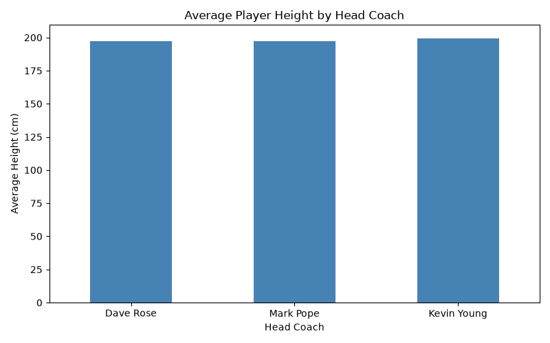
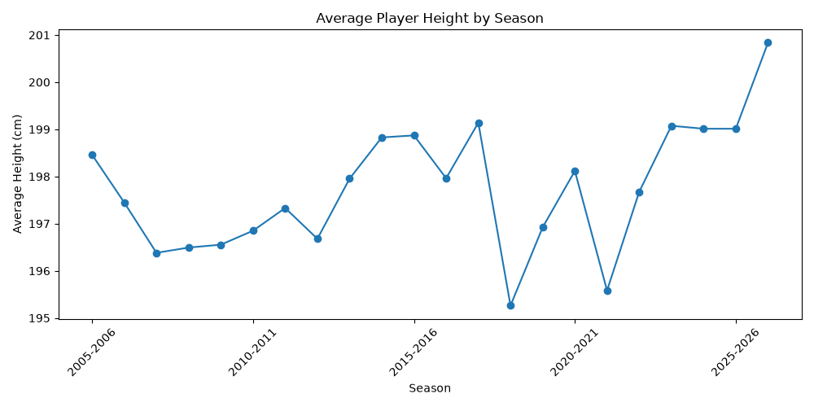
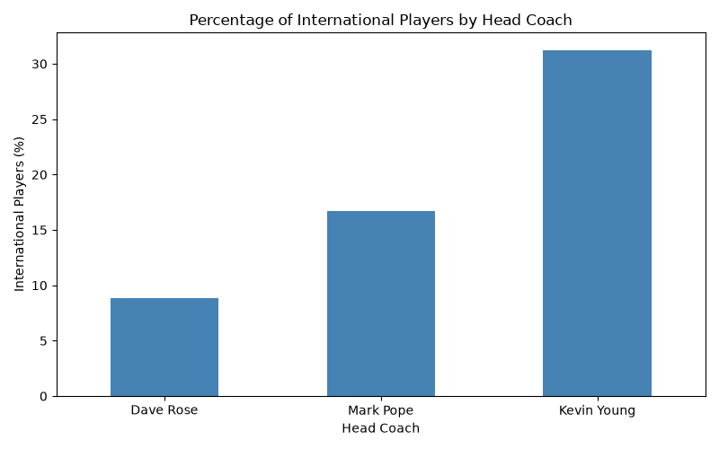
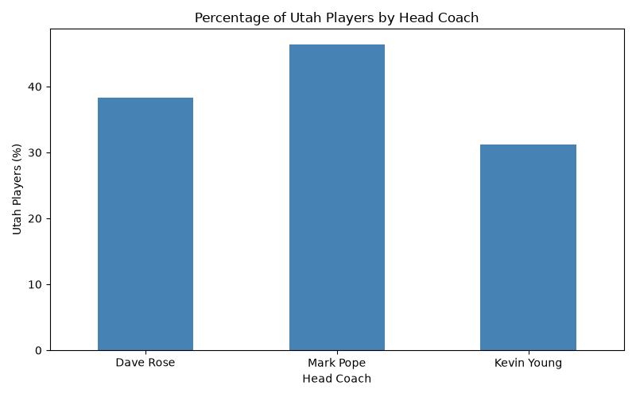

---
title: "BYU Men's Basketball Rosters: How Has the Program Changed?"
subtitle: "Exploring 22 seasons of roster data with Python"
author: "Joseph Asay"
date: "2026-11-06"
toc: true
---

## Why BYU basketball?

I'm interested in basketball analytics, and I wanted to build a dataset that could tell me something about a program I follow closely. BYU men's basketball has had three head coaches since 2005: Dave Rose, Mark Pope, and Kevin Young. Each has had a different approach to building a roster, so I thought it would be interesting to see whether those changes show up in the data.

My main question was: **How has BYU's roster composition changed across these coaching eras?** More specifically, have players gotten taller? Has the program recruited more internationally? And how much of the roster has come from Utah?

I decided to collect the rosters myself instead of downloading an existing dataset. That gave me practice with web scraping and let me create a consistent player-by-season dataset for comparison.

## Getting the data

The data comes from [BYU Athletics' official men's basketball roster pages](https://byucougars.com/sports/mens-basketball/roster). Each season has its own page, so I made a list of **22 seasons, from 2005–2006 through 2026–2027**, and looped through them using `requests` and `BeautifulSoup`.

Here's the basic idea behind the scraper:

```python
r = requests.get(url, headers=headers, timeout=15)
r.raise_for_status()
soup = BeautifulSoup(r.text, "html.parser")

cards = soup.select("div.roster-card-item")
```

Once I found the player cards, I extracted each player's name, jersey number, height, class, hometown, previous school, and season. I also located the head coach on each season's page, rather than assigning a coach based on the year. I saved everything to a CSV file with pandas.

### Scraping responsibly

These are publicly displayed athletic rosters; I didn't access accounts or private information. I also used a descriptive user-agent with contact information, included a 15-second request timeout, checked for unsuccessful HTTP responses, and **paused 3–5 seconds between season requests** to avoid sending a rapid burst of traffic.

Public access by itself doesn't establish blanket permission to scrape or republish a website. Anyone running or expanding this project should check the site's current terms and [robots.txt](https://byucougars.com/robots.txt) first, and stop if the site disallows the activity. I haven't established explicit permission from BYU to redistribute the source data, so my [project repository](https://github.com/Joseph-Asay/byu-basketball-roster-analysis) documents how to recreate the dataset instead of treating the source material as unrestricted.

## Cleaning the roster data

The raw data is readable, but some fields aren't ready for analysis. I wrote a separate `clean_data.py` script to create four useful numeric columns: jersey number, height in centimeters, a Utah hometown indicator, and an international hometown indicator.

For example, a listed height such as `6′10″` becomes **208.3 cm**. The conversion is just feet to inches, plus the remaining inches, multiplied by 2.54.

```python
height_split = players["height"].str.replace("″", "", regex=False).str.split("′", expand=True)
feet = pd.to_numeric(height_split[0])
inches = pd.to_numeric(height_split[1])

players["height_cm"] = ((feet * 12 + inches) * 2.54).round(1)
```

For the hometown variables, I checked the final location in each hometown string. `utah` equals 1 when that location is Utah. `international` equals 1 when it matches a country in a list I built from the dataset.

That approach works for these 22 seasons, but **the country list needs to be reviewed if additional seasons are added**. Also, hometown is not the same thing as citizenship or nationality.

## What does the dataset look like?

The cleaned dataset has **346 rows and 12 columns**. One row represents **one player on one season's roster**. A player listed in four seasons therefore appears four times. This is important: the numbers below describe *player-season roster entries*, not 346 different people.

| Head coach | Seasons | Roster entries | Avg. listed height | International hometown | Utah hometown |
|---|---:|---:|---:|---:|---:|
| Dave Rose | 14 | 214 | 197.5 cm | 8.9% | 38.3% |
| Mark Pope | 5 | 84 | 197.5 cm | 16.7% | 46.4% |
| Kevin Young | 3 | 48 | 199.5 cm | 31.3% | 31.3% |

Because the coaches have different numbers of seasons, **percentages are more useful than raw counts** for comparing hometown patterns.

## What stood out in the exploratory analysis?

### 1. Height changed, but not dramatically



I used pandas' `groupby()` method to calculate each coach's average roster height:

```python
players.groupby("head_coach")["height_cm"].mean().plot(kind="bar")
```

Rose's and Pope's rosters both averaged about **197.5 cm**, while Young's averaged **199.5 cm**, roughly a two-centimeter difference. That is interesting, but it's a pretty modest change, and we shouldn't interpret it as proof that one coach deliberately prioritizes height.

### 2. Individual seasons tell a less consistent story



Season averages move up and down quite a bit, even within the same coaching tenure. I grouped the data by season and plotted the average:

```python
players.groupby("season")["height_cm"].mean().plot(kind="line")
```

This is a good reminder that coaching-era averages can hide year-to-year variation. A single roster can have a different mix of guards, wings, and centers without signaling a long-term trend.

### 3. International hometowns became more common



This was my most interesting finding. The share of roster entries with hometowns outside the United States increased from **8.9% under Rose** to **16.7% under Pope**, then to **31.3% under Young**.

I used the cleaned binary column and calculated its mean; the average of a 0/1 column is the proportion of 1s.

```python
(players.groupby("head_coach")["international"].mean() * 100).plot(kind="bar")
```

It suggests BYU's roster has become more geographically international, at least by the hometowns listed on the official roster pages.

### 4. Utah's share also changed



Pope's rosters had the largest Utah hometown share at **46.4%**. That compares with **38.3%** under Rose and **31.3%** under Young.

I wouldn't say this proves a particular recruiting strategy, but it gives us another difference worth exploring.

## What I learned (and what's next)

For me, the biggest takeaway was seeing how scraping a fairly simple website could lead to an original dataset and a few useful questions. The **international hometown trend** stood out much more than the height difference.

There are limitations. The current **2026–2027 roster may still change**, listed heights aren't independently measured here, and the three coaching tenures cover different lengths of time. The hometown indicators also simplify some complicated geographic backgrounds. These are descriptive comparisons, not evidence that the coaches caused the differences.

If I expanded the project, I'd look at class standing and previous schools, or compare individual seasons in more detail. I'd also validate the international classification more systematically.

If you'd like to try something similar, start with one season's page, inspect the HTML, get one player card working, and only then loop over the other seasons.

My separate [BYU roster analysis GitHub repository](https://github.com/Joseph-Asay/byu-basketball-roster-analysis) contains the scraper, cleaning script, dependencies, and instructions for reproducing the data.

## Additional Resources

- [Official BYU Men's Basketball Rosters](https://byucougars.com/sports/mens-basketball/roster)
- [Beautiful Soup Documentation](https://www.crummy.com/software/BeautifulSoup/bs4/doc/)
- [pandas GroupBy Documentation](https://pandas.pydata.org/docs/user_guide/groupby.html)
- [BYU Roster Analysis GitHub Repository](https://github.com/Joseph-Asay/byu-basketball-roster-analysis)
